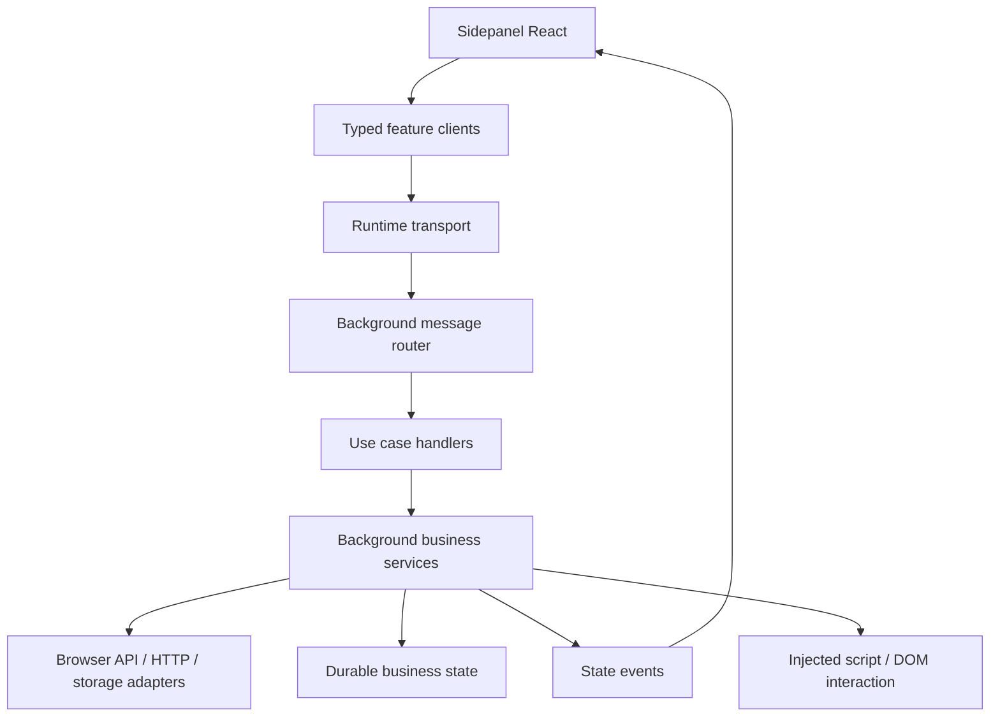

# R0 — Background & Sidepanel Capability Audit

Status: static audit complete for inspected entrypoints and service paths; runtime verification pending.
Date: 2026-11-16
Scope: documentation only. No production behavior or message contract changes.

## 1. Baseline and evidence

- Background main: [10475467188d93a295d55f95dac3a7354cff78c8](https://github.com/vutuantrung/working-chrome-extension-background/tree/10475467188d93a295d55f95dac3a7354cff78c8)
- Sidepanel main: [b0fe47ced972053f3e596f3b4b7b9a0170377bed](https://github.com/vutuantrung/working-chrome-extension-sidepanel/tree/b0fe47ced972053f3e596f3b4b7b9a0170377bed)

Đã kiểm tra Git tree của cả hai repo và đọc các file trọng yếu được dẫn dưới đây. Không chạy npm/pnpm install, typecheck, build, browser tests hoặc external API thật. Không tuyên bố đã audit từng dòng của mọi component. Một lần quét đồng loạt Sidepanel vượt giới hạn số tool calls; các kết luận được giới hạn ở các file đã đọc thành công. Mọi trạng thái Available chỉ nói về sự tồn tại của code, không chứng nhận runtime correctness.

## 2. Architecture direction

Background owns extension business logic and durable business state. Sidepanel owns presentation state, navigation, form drafts, theme and language. Content/injected scripts own page DOM interaction. Public runtime commands are allowlisted use cases, NOT arbitrary service/method invocation. Separate source repositories must be assembled into a single extension package/identity or provided an explicitly designed external transport; two separately installed extensions cannot assume ordinary internal runtime messaging reaches one another.



Proposed, not implemented in R0. Retain existing contracts during migration, adapt at the boundary, and migrate one vertical slice at a time.

## 3. Background capability inventory

Paths in this section are relative to entrypoints/background/ at pinned HEAD.

| Capability | Evidence | Status / observation |
|---|---|---|
| Composition root | bootstrap.ts, application-services.ts | 13 initialized services: tab, proxy, alarm, cookie, schedule, action, download, runtime, window, storage, sync, script, http |
| Browser selection | bootstrap.ts, index.ts | Chrome only; Firefox branch throws |
| Runtime router | handlers/extension/runtimeHandler.ts:399-468 | Existing switch dispatch; reuse first |
| Listener registration | infrastructure/chrome-api/init.ts, index.ts | Registered after async bootstrap; cold-start risk |
| HTTP | services/http.services.ts, infrastructure/api/index.ts | Axios instance, 401 AUTH_EXPIRED notification, six API namespaces |
| External API gateway | handlers/extension/externalServiceHandler.ts | 22 allowlisted operations under CALL_EXTERNAL_SERVICE |
| Storage | services/storage.services.ts | Cache plus durable browser storage; recursion/cache consistency issues below |
| Proxy | services/proxy.services.ts | SET_PROXY and health checks |
| Cookie/tabs/scripting | services/*.services.ts, infrastructure/chrome-api/ | Adapter-backed primitives available; not all public business use cases exposed |
| Schedule/sync | services/schedule.services.ts, services/sync.services.ts | Existing services wired into bootstrap |
| Session lifecycle | handlers/extension/systemHandlers.ts | Initialize after login, cleanup, periodic checks; not complete ownership of login |
| Evidence capture | handlers/eviden-collection/index.ts | Capture visible tab and persist cropped screenshot |
| Runtime memory | state.ts | Locks, caches, injected tab map; worker restart loses memory |
| Side panel service | application-services.ts, bootstrap.ts | Declared optional but not returned by composition root |
| Extension service | services/extension.services.ts, bootstrap.ts | Implementation exists but not initialized/returned |
| Testing | tests/background/e2e/fixture, service-worker.spec.ts, mocks/chrome.ts | Test files exist; production router coverage not established |

### 3.1 Current public message compatibility

Source: Sidepanel application/services/ExtensionCommandService.ts and Background handlers/extension/runtimeHandler.ts, systemHandlers.ts, services/storage.services.ts, services/proxy.services.ts.

| Sidepanel method | Existing type | Existing input/response summary | Migration note |
|---|---|---|---|
| getSettings | GET_SETTINGS | response.data | Retain legacy |
| getUserInfo | GET_USERINFO | response.data | Retain; define sanitized session view |
| saveSettings | SET_SETTINGS | inputs.data; success | Two-step operation with SET_PROXY; partial failure |
| saveSettings / setProxy | SET_PROXY | inputs.extension_proxy; success | Check failure explicitly |
| initializeAfterLogin | INITIALIZE_AFTER_LOGIN | inputs.extension_session + context; handler success/error | Not equivalent to full login |
| startPeriodicCheck | START_PERIODIC_CHECK | success/error | Background lifecycle owned |
| clearDataAfterLogout | CLEAR_DATA_AFTER_LOGOUT | success/error | Not equivalent to full remote logout |
| getFacebookAccountCache | GET_FB_ACCOUNT_CACHE | ok/data | Different envelope |
| cancelTask | CANCEL_TASK | inputs.taskId; success/error/unchanged | Client currently discards outcome |

All nine distinct message types have a matching dispatch case. This is source-level compatibility only, not an integration test. Additional existing router cases include UPDATE_SETTINGS, UPDATE_ARCHIVE, GET_TAB_ID, SET_BADGE_TEXT, SCRIPT_EXECUTE_RESULT, CHANGE_TAB_URL, DOWNLOAD_IMAGE, CAPTURE_SCREENSHOT, SCREENSHOT_CROPPED, GET_FB_ACCOUNT, FETCH_JG_RESPONSE, FETCH_JG_PREPARATION_DATA, REPORT_JG_RESPONSE, SEND_ADD_SOURCE_REQUEST, BODY_DATA_INTERCEPTED and CALL_EXTERNAL_SERVICE. Do not remove existing content-script contracts.

### 3.2 CALL_EXTERNAL_SERVICE inventory

Legacy envelope: { type: "CALL_EXTERNAL_SERVICE", inputs: { serviceName, body } }. Each allowlisted operation delegates to the HTTP infrastructure and sends the response. Raw result formats and error behavior need contract tests.

| Domain | serviceName values |
|---|---|
| Extension user | login, loginByApiKey, logout, updateExtensionSession, getExtensionConfigInfo, deactivatePersona, activatePersonaSession |
| Persona | getPersonas, createPersona, getPersonaById |
| Proxy | getProxiesByPersona, getProxyInfo |
| Social account | getSocialAccountProxy, getSocialAccountInfo, getSocialAccountGroups, getSocialAccountsByPersona |
| Evidence | getProfileCases, createProfileCase, patchCaseInfo, postCaseImages |
| Groups | getMemberSourcesGroup, getMemberSourcesApi |

Important: this gateway is already available, but it only exposes lower-level external API calls. For example login + persistence + initialization + proxy resolution is a larger application use case. Keep the existing allowlist for compatibility; do not expand to arbitrary URLs, methods or service internals. The handlers use .then(sendResponse) without returning/awaiting those promises or attaching a rejection handler; outer dispatch catch cannot reliably catch their rejected promises. Unknown serviceName returns null. Validate input, caller, authorization and redacted errors before public migration. Compare DTOs and filters: existing group gateway passes accountId/status/search/offset/limit but Sidepanel group source also accepts platform/type filters. Do not assume semantic parity.

## 4. Sidepanel inventory

Paths relative to entrypoints/sidepanel/.

| File | Evidence / current responsibility |
|---|---|
| main.tsx, App.tsx | UI bootstrap, HashRouter, AuthProvider, AppRoutes |
| application/services/SidepanelServices.ts | module-level singleton adapter selection |
| types/BrowserPorts.ts | eight ports for storage/runtime/tabs/cookies/proxy/scripting |
| application/services/ExtensionCommandService.ts | existing runtime client, nine distinct legacy types |
| contexts/AuthContext.tsx | ~54 KB; login, restoration, persona, social accounts, cookies, proxy, persistence and navigation |
| routes/AppRoutes.tsx | routing plus proxy health polling/storage and tab detection |
| components/AutomationTab.tsx | reads/writes automationByUser; settings form |
| components/Automation/TaskMonitorTab.tsx | reads activities/taskList and calls cancelTask |
| pages/eviden-studio/use-eviden-studio.ts | draft/pending screenshots, API save coordination |
| application/services/ScreenshotCaptureService.ts | active tab check, writes marker, injects selector |
| infrastructure/chrome/screenshotSelector.ts | actual page DOM selection and crop; runtime screenshot messages |
| pages/groups/GroupPage.tsx | filters, pagination, fetch with placeholder ID |
| pages/settings/SettingsPage.tsx | UI preferences; imported by bootstrap |
| infrastructure/web/BrowserRuntimeAdapter.ts | dispatch DOM event then return undefined; not real request/response |
| infrastructure/web/BrowserExtensionStorageAdapter.ts | localStorage implementation; subscriptions no-op |

## 5. Service ownership matrix

A = matching source capability; P = partial use case or primitive; M = missing public capability in inspected router. Ownership is proposed, not yet implemented.

| Use case | Current Sidepanel | Background capability | Target owner | Required migration |
|---|---|---|---|---|
| Login / API key login | AuthContext.processLoginResponse and login calls | P: CALL_EXTERNAL_SERVICE login/loginByApiKey | BG | AUTH_LOGIN / AUTH_LOGIN_BY_API_KEY use cases |
| Logout | AuthContext | P: logout + CLEAR_DATA_AFTER_LOGOUT | BG | unified AUTH_LOGOUT, idempotent cleanup |
| Restore session | checkAuthAndRestore | P: GET_USERINFO, INITIALIZE_AFTER_LOGIN | BG | SESSION_GET_STATE / restore on worker boot |
| Persona list/load | SelectPersona, AuthContext | A: getPersonas/getPersonaById | BG | typed queries |
| Persona selection/switch | switchPersona, applyPersonaSession | P: activatePersonaSession/deactivatePersona | BG | PERSONA_SELECT/SWITCH transaction or compensations |
| Social account lookup | AuthContext | A: API allowlist | BG | typed queries |
| Platform login mode | loginWithMode, cookie snapshot helpers | P: cookie/tab primitives, initialization | BG | PLATFORM_SET_LOGIN_MODE |
| Cookie operations | browserCookies, AuthContext | A: CookieService primitive | BG | expose intent, never general cookie dump |
| Effective proxy resolution | AuthContext.applyEffectiveProxy, utils/resolveEffectiveProxy.ts | P: ProxyService | BG | resolve and apply policy, PROXY_GET_STATE |
| Proxy health | AppRoutes storage/polling | A: ProxyService, alarm | BG | state query/events |
| Automation config | AutomationTab, ExtensionCommandService | P: settings and schedule | BG | AUTOMATION_GET/UPDATE_CONFIG |
| Task cancel | TaskMonitorTab | A: CANCEL_TASK | BG | typed wrapper and error propagation |
| Task list/activities | TaskMonitorTab reads storage | M: no explicit query found | BG | TASK_LIST/ACTIVITY_LIST and events |
| Evidence capture | ScreenshotCaptureService | P: CAPTURE_SCREENSHOT/SCREENSHOT_CROPPED | BG + injected script | capture initiation/result lifecycle |
| Evidence draft/save | use-eviden-studio hook | P: profile case API and crop persistence | BG for saved state; UI for unsaved edit form | case save use case, capture IDs, revision |
| Group query | GroupPage | P: source-member API allowlist | BG | GROUP_LIST with filters/pagination |
| Settings + proxy | ExtensionCommandService.saveSettings | P: SET_SETTINGS + SET_PROXY | BG | typed update with explicit failure policy |
| Business storage | appStorage/extensionStorage direct calls | A: StorageService | BG | domain-specific stores; no generic privileged storage RPC |
| Theme/language | SettingsPage, i18n | N/A | UI | retain preferences service |
| Navigation/form draft | React Router, components | N/A | UI | retain local presentation logic |

## 6. Persistence and event ownership

ChromeAppStorageAdapter strips local: prefix and ChromeExtensionStorageAdapter uses chrome.storage.local directly. Therefore both can address the same underlying durable keys; neither defines isolated ownership. Do not migrate by blindly duplicating keys.

| Current key / family | Proposed authority | Consumer |
|---|---|---|
| user, isApikeySession, apikey | BG session; apikey may be injected by existing desktop integration | sanitized session snapshot only |
| selectedPersonaId, personaProxy, allSocialAccounts, personaSocialAccounts, facebookAccounts, personaFacebookAccounts | BG persona/session | persona summary queries |
| extensionProxy, activeProxy, proxyHealth, fbLoginMode | BG proxy/platform | read-only view/events |
| manualPlatformCookies, manualFacebookCookies | BG sensitive session data | no raw cookie values through UI contract |
| settings, automationByUser | BG configuration | typed settings query/update |
| taskList, activities | BG task lifecycle | task query/events |
| screenshots_<caseId>, lastUnsavedProfileCase, newProfileCaseCache | BG evidence persistence (draft policy to confirm) | draft view and update commands |
| UI preferences/theme/language, ephemeral route/form state | Sidepanel | local UI |

Some values also exist in DOM localStorage (selectedPersonaId, selectedPersona, fbLoginModeSelected); service worker cannot read DOM localStorage. Plan a one-time migration via validated command or reconcile from authoritative BG state. Preserve desktop injection and legacy key readers until all consumers are migrated.

Existing AUTH_EXPIRED notification originates from HttpService on 401. Existing UI also listens to storage changes and localStorageSync. Future public events: SESSION_CHANGED/EXPIRED, PERSONA_CHANGED, PROXY_HEALTH_CHANGED, TASK_CHANGED, EVIDENCE_CAPTURE_COMPLETED. These names are proposals, not current contracts. Subscribe then fetch snapshot with revision/sequence to avoid lost updates; refresh on reconnect; never assume events are replayable. Persist business state and recover after worker restart.

## 7. Risk register and baseline remediation

Severity is an assessment; runtime reproduction pending.

| ID | Severity | Finding | Evidence / recommended acceptance test |
|---|---|---|---|
| R0-01 | P0 | Sidepanel WXT config references absent entrypoints/background/index.ts | sidepanel wxt.config.ts and Git tree. Assemble single-extension fixture; verify generated manifest and load |
| R0-02 | P0 | Unresolved Sidepanel API references | AuthContext.tsx import api commented but api.* used; use-eviden-studio.ts and SelectPersona.tsx use api without import; GroupPage.tsx uses getMemberSourcesGroup without import; source-member.api.ts uses http without import, helpers-http.ts and api/index.ts commented. Run tsc --noEmit and fix via typed runtime bridge, not restore direct privileged HTTP by default |
| R0-03 | P0 | Cold-start listener registration | BG index.ts registers after createApplicationServices and dynamic import. Register listeners synchronously at entrypoint; delegate to initialization promise; test first message after worker termination |
| R0-04 | P0 | Storage cache miss recursion | BG services/storage.services.ts: _cachedStorage initialized {}; if missing key and cache truthy, awaits null _storageInFlight then recursively calls itself; normal fetch path unreachable while cache truthy. Test missing key, empty storage, concurrent requests and rejection |
| R0-05 | P1 | External API rejection not propagated | externalServiceHandler.ts .then without await/return/catch; test rejection, unknown service, invalid body, exactly one response |
| R0-06 | P1 | Optional services can silently do nothing | sidePanel and extension declared but omitted by bootstrap; screenshot open optional; return typed unsupported capability, test service missing |
| R0-07 | P1 | Multiple writers and cache consistency | Sidepanel writes shared storage while BG cache merges data; verify storage change handling, deleted keys, array replacement and concurrent updates; use single writer per domain |
| R0-08 | P1 | Partial settings/proxy failure | ExtensionCommandService.saveSettings issues two commands; test first success/second failure, explicit partial result or compensation |
| R0-09 | P1 | Missing validation/security boundary | audit caller/context allowlist, authentication/authorization, schema validation, rate/size limits; avoid logging tokens, cookies, proxy credentials |
| R0-10 | P1 | Screenshot lifecycle/race | begin() means injection started not saved; CAPTURE_SCREENSHOT captures visible tab without explicit window binding; concurrent screenshot read-modify-write; test cancellation, tab/window switch, save failures |
| R0-11 | P1 | Group data is not production-ready | GroupPage placeholder "some_id"; source-member API calls hardcoded sample ID and returns sampleData; test real ID, filters, pagination; no fabricated fallback |
| R0-12 | P2 | Web/Firefox capability mismatch | Web runtime returns undefined, storage subscriptions no-op; Firefox not supported in BG bootstrap; test explicit unsupported/mock behavior |
| R0-13 | P2 | Worker restart and task durability | state.ts maintains in-memory caches and locks; test restart, duplicate requests, task reconciliation |
| R0-14 | P2 | Manifest/dependency/test hygiene | broad host permissions, two lockfiles, background-oriented tests in sidepanel; audit actual needed permissions and build scripts |

## 8. Compatibility and R1 design constraints

- Existing message types/inputs must remain stable until all consumers migrate (including content scripts).
- Public contract package should contain schemas/types/DTOs only, not Chrome or React implementation.
- Version envelope or negotiate supported version; correlation ID, typed success/error, validation, timeout and transport failure handling.
- Preserve legacy inputs/response shapes through a compatibility adapter. Do not change inputs to payload globally.
- Distinguish queries, commands and events; no arbitrary service name+method execution.
- Do not send raw auth tokens, cookies, proxy passwords or internal errors to UI.
- Long-running command returns operation ID; durable state and idempotency for retries; no assumption that MV3 worker stays alive.
- Use semantic feature clients rather than expose generic storage or browser primitives.
- Prefer constructor injection/manual composition root; no new DI framework required.
- Coding standards: intent-revealing methods, extract method, clear ownership and no opportunistic unrelated rewrites.

## 9. Migration sequence and gates

| Phase | Deliverable | Prerequisite / acceptance |
|---|---|---|
| R0 | This baseline, ownership and gap register | static audit complete; tests not run |
| R0 remediation | resolve R0-01 to 05 baseline blockers before feature migration | integrated fixture, cold-start message, cache miss, API error and compile |
| R1 | shared runtime contracts + legacy mapping ADR | agree public DTOs, versioning, packaging, error semantics |
| R2 | runtime client, validated router/handlers boundary | one round-trip with typed success/error, timeout, unsupported command, sender validation |
| R3 | auth/session vertical slice | login/logout/restore, API-key integration, worker restart |
| R4 | persona/social account/platform workflows | select/switch, rollback/partial failure, cookie and proxy policy dependencies |
| R5 | proxy/browser capability consolidation | single owner, health snapshot/event |
| R6 | automation/task migration | list/cancel, durable task status and recovery |
| R7 | evidence/group migration | capture result lifecycle, case persistence and real filtered queries |
| R8 | event-driven state synchronization consolidation | reconnect, missed/duplicate event recovery |
| R9 | standalone mock/Web and Firefox capability work | explicit environment support matrix |
| R10 | full integration/regression suite | Chrome real extension E2E; contract tests and no direct business writes in UI |

Tests must begin in R0 remediation/R1/R2; R10 is consolidation, not first test phase. R4/R5 dependencies may require factoring proxy/cookie ports earlier without moving all proxy features.

### R0 exit checklist

- [x] Pin both repository revisions.
- [x] Identify existing service composition and public router capability.
- [x] Identify legacy command mapping and API allowlist.
- [x] Propose service ownership, persistence/event policy and migration order.
- [x] Record static risks and verification criteria.
- [ ] Run sidepanel and background typecheck/build separately and integrated extension build.
- [ ] Reproduce cold start, missing storage key, external API rejection and existing commands in browser.
- [ ] Confirm packaging approach and shared contracts distribution.
- [ ] Approve R1 contract decisions. No production source changes in R0.

Recommended local checks (not executed here):
```bash
pnpm install --frozen-lockfile
pnpm compile
pnpm build
pnpm background:test
pnpm background:test:e2e
```
Run only scripts present in the respective package.json; separate missing-entrypoint/build failure from service behavior. Use mocked HTTP and nonproduction test accounts. Do not run real social account tasks for baseline testing.

## 10. Source index (pinned)

Background: [bootstrap](https://github.com/vutuantrung/working-chrome-extension-background/blob/10475467188d93a295d55f95dac3a7354cff78c8/entrypoints/background/bootstrap.ts), [entrypoint](https://github.com/vutuantrung/working-chrome-extension-background/blob/10475467188d93a295d55f95dac3a7354cff78c8/entrypoints/background/index.ts), [runtime router](https://github.com/vutuantrung/working-chrome-extension-background/blob/10475467188d93a295d55f95dac3a7354cff78c8/entrypoints/background/handlers/extension/runtimeHandler.ts), [external gateway](https://github.com/vutuantrung/working-chrome-extension-background/blob/10475467188d93a295d55f95dac3a7354cff78c8/entrypoints/background/handlers/extension/externalServiceHandler.ts), [storage](https://github.com/vutuantrung/working-chrome-extension-background/blob/10475467188d93a295d55f95dac3a7354cff78c8/entrypoints/background/services/storage.services.ts).

Sidepanel: [services](https://github.com/vutuantrung/working-chrome-extension-sidepanel/blob/b0fe47ced972053f3e596f3b4b7b9a0170377bed/entrypoints/sidepanel/application/services/SidepanelServices.ts), [commands](https://github.com/vutuantrung/working-chrome-extension-sidepanel/blob/b0fe47ced972053f3e596f3b4b7b9a0170377bed/entrypoints/sidepanel/application/services/ExtensionCommandService.ts), [AuthContext](https://github.com/vutuantrung/working-chrome-extension-sidepanel/blob/b0fe47ced972053f3e596f3b4b7b9a0170377bed/entrypoints/sidepanel/contexts/AuthContext.tsx), [WXT](https://github.com/vutuantrung/working-chrome-extension-sidepanel/blob/b0fe47ced972053f3e596f3b4b7b9a0170377bed/wxt.config.ts).
